# Technology-Store

Technology-Store, this website is a job for an educational institution and in reality is not a real hardware store.

Учебный интернет-магазин комплектующих для ПК: процессоры, видеокарты, материнские платы, память, накопители, блоки питания и корпуса. Здесь можно выбрать детали, собрать из них компьютер с проверкой совместимости, оформить заказ и копить бонусы.

<p align="center">
  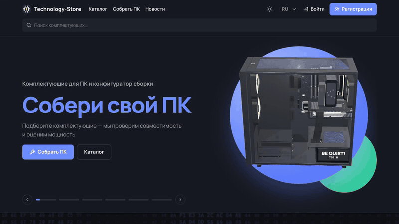
</p>

## Как выглядит

| Главная: собранный ПК крутится и меняет детали | Конфигуратор: детали встают в 3D-корпус |
|---|---|
| 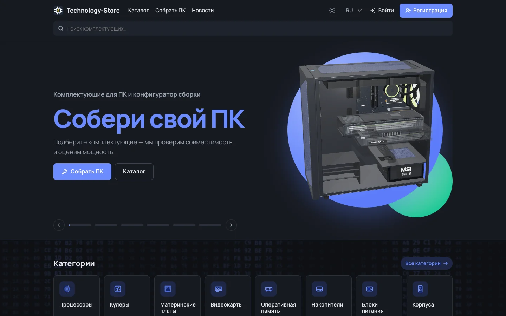 | 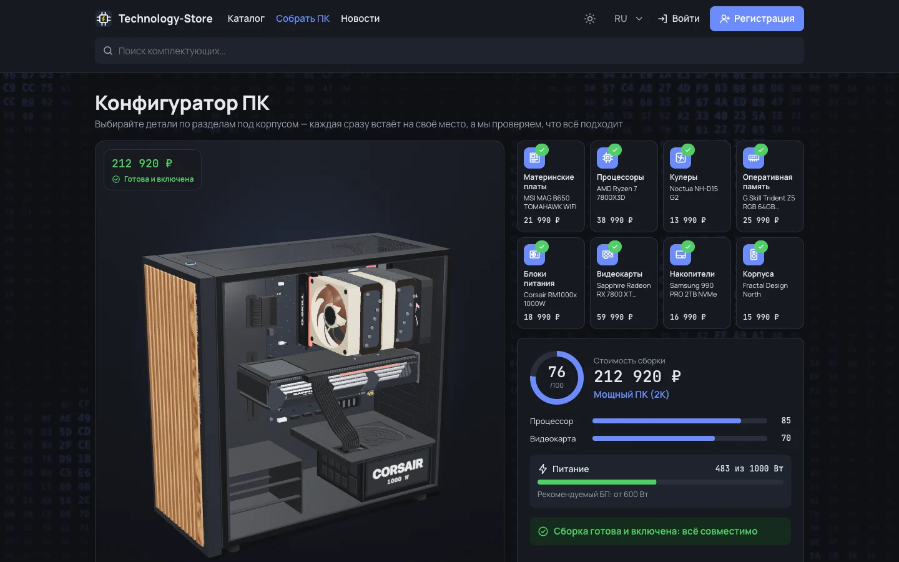 |
| **Каталог** с фильтрами и бесконечной прокруткой | **Страница товара** с галереей и лупой |
| 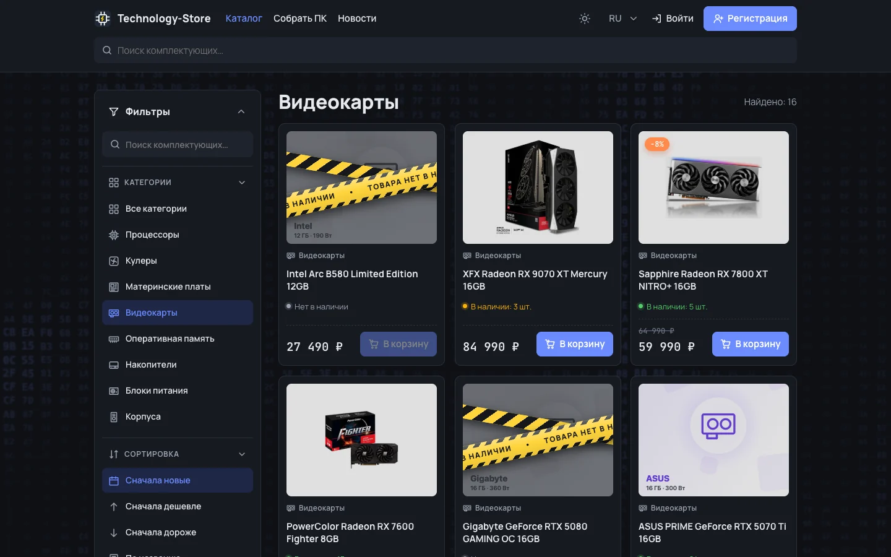 | 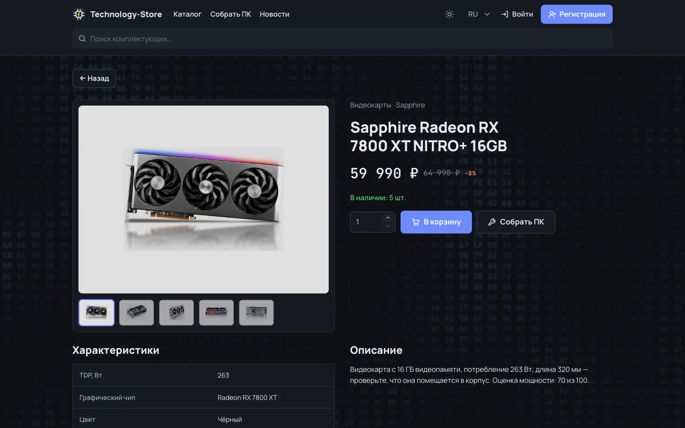 |
| **Новости, акции и события** | **Админка:** статистика, заказы, товары, ремонт |
| 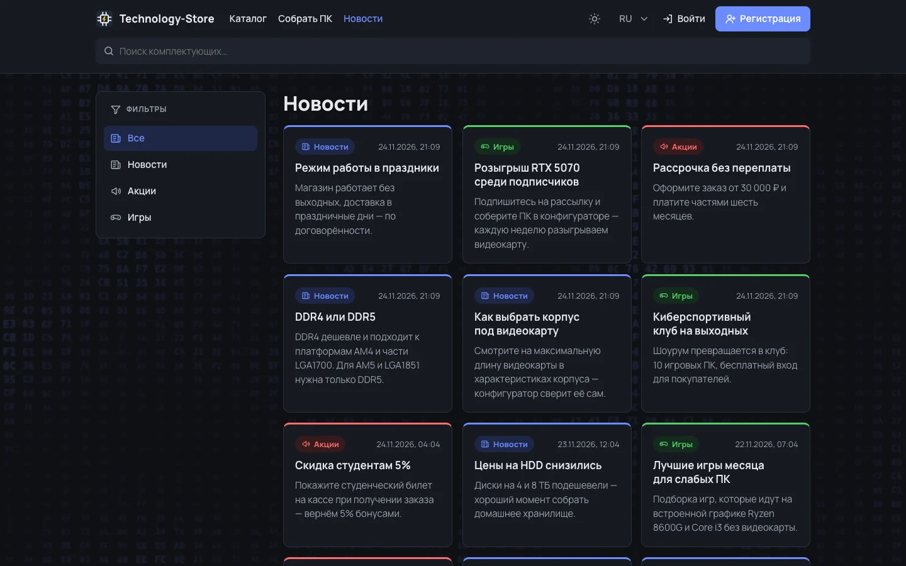 | 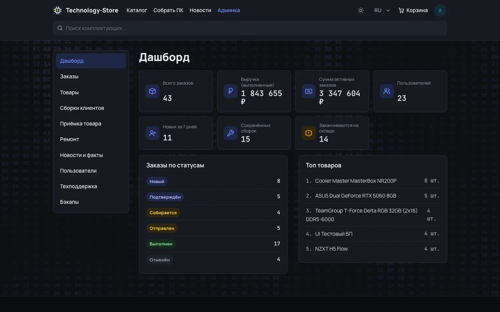 |
| **Светлая тема** | **Конфигуратор в светлой теме** |
| 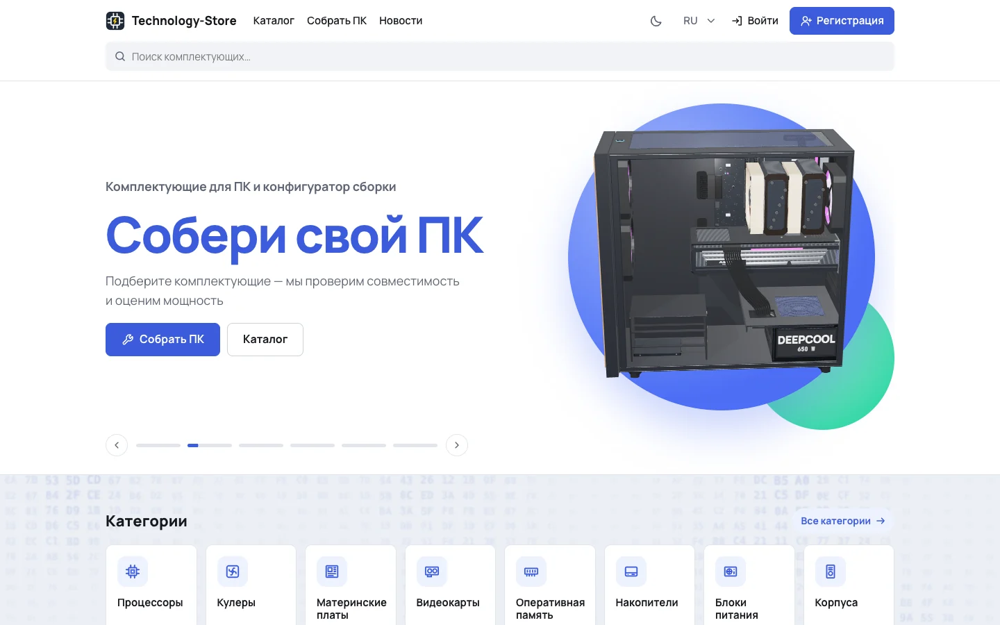 | 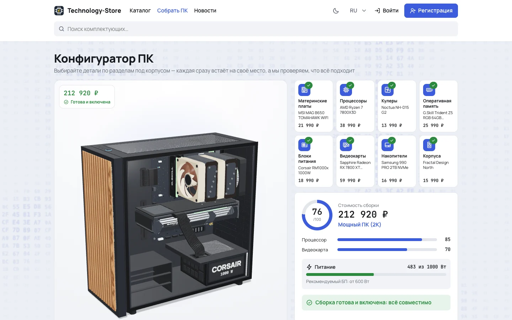 |

<details>
<summary><b>На телефоне</b></summary>

| Главная | Конфигуратор | Каталог |
|---|---|---|
| 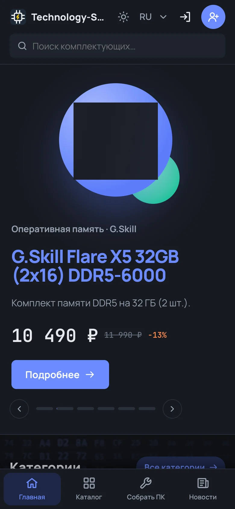 | 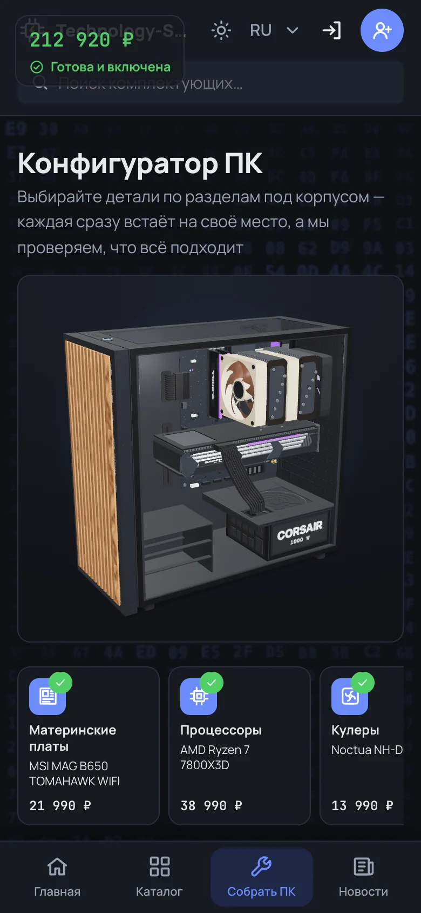 | 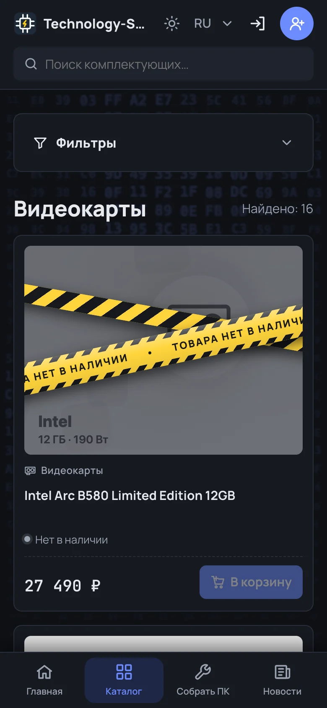 |

</details>

## Возможности

- **Каталог** с фильтрами, поиском и бесконечной прокруткой — без переключения страниц.
- **Конфигуратор ПК:** проверяет, подходят ли детали друг к другу (сокет, память, блок питания, размеры), считает мощность сборки и определяет уровень: офисный, игровой, мощный или топовый.
- **Корзина и заказы** со статусами: от «Новый» до «Выполнен».
- **Бонусы:** 500 за регистрацию, 5% с каждого заказа, оплата бонусами до 30% суммы.
- **Главная страница:** акции, скидки, новости о железе и играх, интересные факты.
- **Роли:** клиент, менеджер, инженер, администратор. Каждый видит только свои разделы, права выдаёт API.
- **Админка:** статистика, заказы, товары, проверка сборок клиентов, новости, пользователи и роли.
- **Два языка интерфейса:** русский и английский.

## Технологии

Python (FastAPI), PostgreSQL, Docker. Фронтенд — HTML и JavaScript без сборки. Фронтенд и бэкенд — отдельные части, связанные через API.

## Быстрый старт

Нужен только [Docker Desktop](https://www.docker.com/products/docker-desktop/).

```bash
./run.sh start
```

После запуска сайт открывается по адресу http://localhost:5173.

Все команды: `./run.sh help`. Подробнее — [docs/SETUP.md](docs/SETUP.md).

## Документы

| Документ | О чём |
|---|---|
| [docs/SETUP.md](docs/SETUP.md) | как запустить проект |
| [docs/DEPLOY.md](docs/DEPLOY.md) | как запустить сайт на своём сервере (VPS) для всех |
| [docs/TECH.md](docs/TECH.md) | какие технологии используются и для чего |
| [docs/PHOTOS.md](docs/PHOTOS.md) | какие фото товаров нужны и как их добавить |
| [frontend/README.md](frontend/README.md) | как устроен фронтенд |
| [resources/icons/README.md](resources/icons/README.md) | иконки сайта |
| [docs/API.md](docs/API.md) | как работать с API, роли и права |
| [docs/TESTS.md](docs/TESTS.md) | автотесты: как запускать и что проверяют |
| [docs/TRANSLATIONS.md](docs/TRANSLATIONS.md) | переводы интерфейса |
| [docs/COMMITS.md](docs/COMMITS.md) | как оформлять коммиты |
| [CHANGELOG.md](CHANGELOG.md) | что изменилось в проекте |
